     

## Hola, mi Nombre es  Diego Fernando Banegas Bruno 👋

🎓 Estudiante & Desarrollador Full-Stack | HTML | CSS | JavaScript 
🚀 Multifacético, autodidacta y siempre hambriento de nuevos retos. 

💡 Lo que hago:

Desarrollo páginas web (frontend y backend) aunque aún no soy Senior... ¡pero voy en camino!

Aprendo rápido y me adapto a cualquier stack (total, ¡Google y Stack Overflow son mis mejores mentores!).

<!--
**Dego77/Dego77** is a ✨ _special_ ✨ repository because its `README.md` (this file) appears on your GitHub profile.

Here are some ideas to get you started:

- 🔭 I’m currently working on ...
- 🌱 I’m currently learning ...
- 👯 I’m looking to collaborate on ...
- 🤔 I’m looking for help with ...
- 💬 Ask me about ...
- 📫 How to reach me: ...
- 😄 Pronouns: ...
- ⚡ Fun fact: ...
-->

## SKILLs:

 

